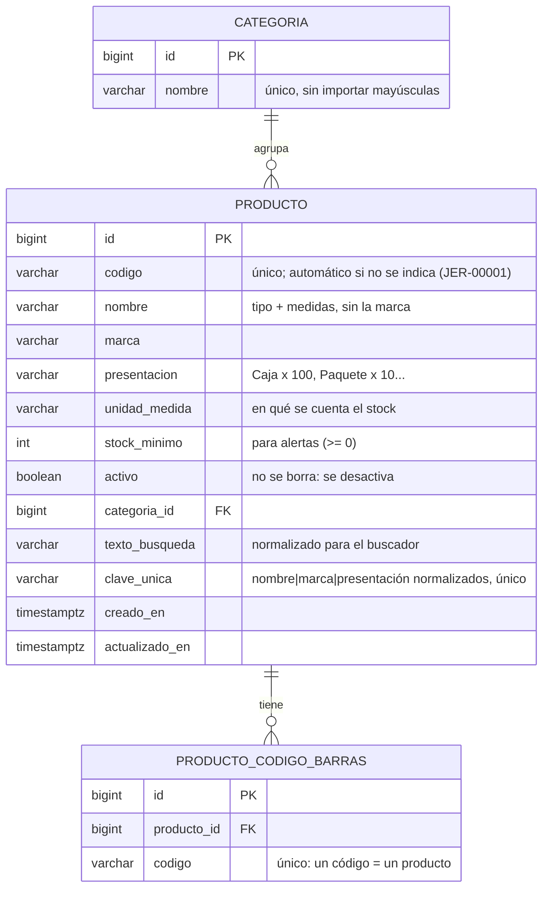
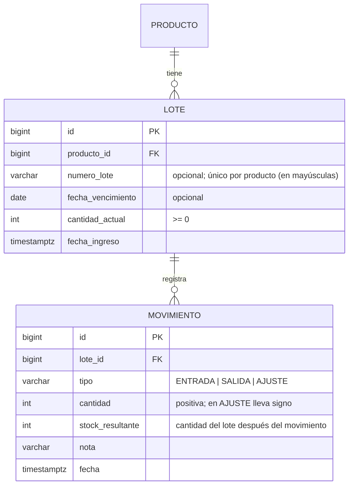
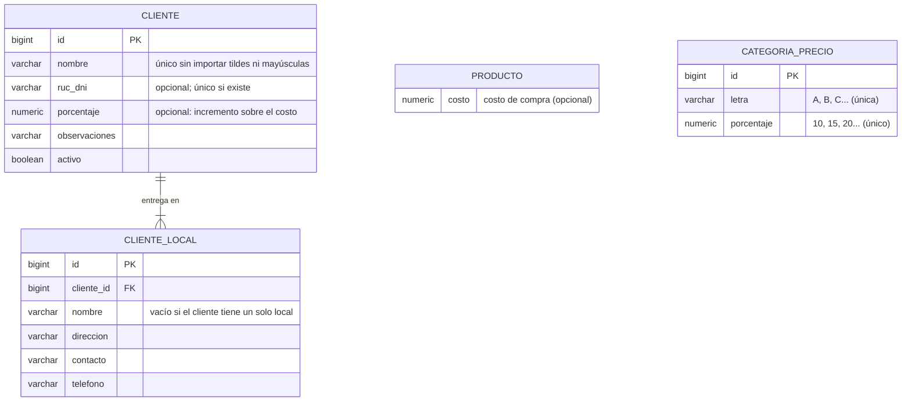

# Modelo de datos

El esquema se crea con migraciones de Flyway en [`backend/src/main/resources/db/migration`](../backend/src/main/resources/db/migration).

## Fase 1: Catálogo

### Decisiones

- **Cada marca o presentación es un producto distinto.** "Jeringa 5 ml · Marca A · Caja x 100" y "Jeringa 5 ml · Marca B · Caja x 100" son dos productos, porque los clientes piden marcas y el precio cambia.
- **Sin duplicados escritos de otra forma.** La columna `clave_unica` guarda nombre, marca y presentación *normalizados*, así que "Gasa estéril 10x10 cm" y "GASA ESTERIL 10 x 10 CM" se detectan como el mismo producto.
- **Un producto puede tener varios códigos de barras.** Por ejemplo, si el proveedor cambia el empaque. El código de barras identifica el producto, **no el lote**.
- **Los productos no se eliminan, se desactivan.** Más adelante tendrán historial de movimientos y pedidos.

### Cómo funciona el buscador

Al guardar un producto se calcula `texto_busqueda`: el código, el nombre, la marca y la presentación en minúsculas y sin tildes, con los números separados de las letras ("5ml" → "5 ml"). La búsqueda aplica la misma normalización y exige que **todas** las palabras coincidan:

| Se busca | Regla | Ejemplo |
|---|---|---|
| Palabra normal | Coincide con el **inicio** de una palabra | `jer` → **jer**inga |
| Número o letra suelta | Debe ser la palabra **completa** | `5` → "5 ml", pero no "x 50"; `m` → "talla M", pero no "Marca" |

## Fase 2: Stock por lote

### Reglas

- **Stock de un producto = suma de sus lotes.** Solo cuenta como *disponible* lo que no está vencido.
- **El vencimiento es por mes y año.** Un lote que vence en 03/2027 se puede usar durante todo marzo, así que la fecha se guarda siempre como el último día de su mes, sin importar el día con el que llegue.
- **FEFO:** una salida toma primero del lote que vence antes y los lotes sin vencimiento van al final. Si no alcanza el stock, **no sale nada** (409).
- **Los lotes vencidos nunca se despachan.** Para sacarlos del inventario se registra un **ajuste** a 0 ("baja por vencimiento").
- **Un número de lote no se repite en el mismo producto.** Si llega una entrada con el mismo número y otra fecha de vencimiento, se rechaza, porque probablemente es un error de digitación. Solo puede haber un lote "sin número" por producto (`UNIQUE NULLS NOT DISTINCT`).
- **La cantidad de un lote solo cambia mediante un movimiento.** Los métodos que la modifican son *package-private* y solo los usa `MovimientoService`, así no hay cambios de stock sin historial.
- **Concurrencia:** las salidas bloquean los lotes que van a usar (`SELECT … FOR UPDATE`). Si dos personas despachan a la vez, la segunda espera a la primera y no se descuentan las mismas unidades dos veces.

### Importación desde Excel

`POST /api/importacion/inventario` lee la hoja **Inventario** de la [plantilla](plantilla_inventario.xlsx), con una fila por lote:

1. **Valida cada fila:** columnas obligatorias, números enteros, costo y vencimiento (`mm/aaaa`; si trae día, se ignora).
2. **Crea lo que falta:** categorías (reconocidas sin importar tildes) y productos (reconocidos por código o por nombre, marca y presentación).
3. **Registra una entrada** por cada fila con cantidad, y guarda el **costo** del producto si la fila lo trae. El costo es del producto, no del lote: dos filas del mismo producto con costos distintos son un error.
4. **Todo o nada:** todo ocurre en una transacción. Si una sola fila tiene error, no se guarda ninguna y el reporte indica fila y motivo.
5. **`soloValidar=true`** (el valor por defecto) ejecuta los mismos pasos y al final deshace todo. Así la vista previa detecta exactamente los mismos problemas que la importación real.

## Precios y clientes

### Reglas

- **Precio de venta = costo × (1 + porcentaje del cliente)**, redondeado a 2 decimales (`HALF_UP`). Ejemplo: costo 4.80 y 15 % → 5.52.
- **El porcentaje se guarda en el cliente como número.** Las categorías de precio solo le ponen una letra a un porcentaje (A = 10 %) para mostrarlo de forma discreta en la app. Un cliente con un porcentaje que no corresponde a ninguna letra, por ejemplo 12.5, es válido.
- **Las categorías son una tabla**, no un valor fijo en el código: se puede agregar una D o cambiar un porcentaje sin programar.
- **El costo, el porcentaje y la letra son datos internos**: no aparecerán en la nota de pedido que recibe el cliente.
- **Un cliente sin porcentaje** es válido: la app lo pedirá en su primer pedido.
- **Todo cliente tiene al menos un local.** Si tiene varios, cada uno necesita un nombre distinto; así el pedido siempre se registra para un punto de entrega con su dirección y su contacto.
- **Los clientes no se eliminan, se desactivan**, igual que los productos.

### Importación de clientes

`POST /api/importacion/clientes` lee la hoja **Clientes** de la [plantilla](plantilla_clientes.xlsx), con **una fila por local**: las filas con el mismo nombre forman un solo cliente. El RUC y el porcentaje son del cliente, así que no pueden diferir entre sus filas. Funciona igual que la de inventario: valida primero, todo o nada, y los clientes que ya existen no se modifican.

## Próximas fases

- **Fase 3:** `pedido` y `pedido_item`, con el precio de cada línea guardado en el pedido. Las salidas de un pedido quedarán vinculadas a sus ítems.
