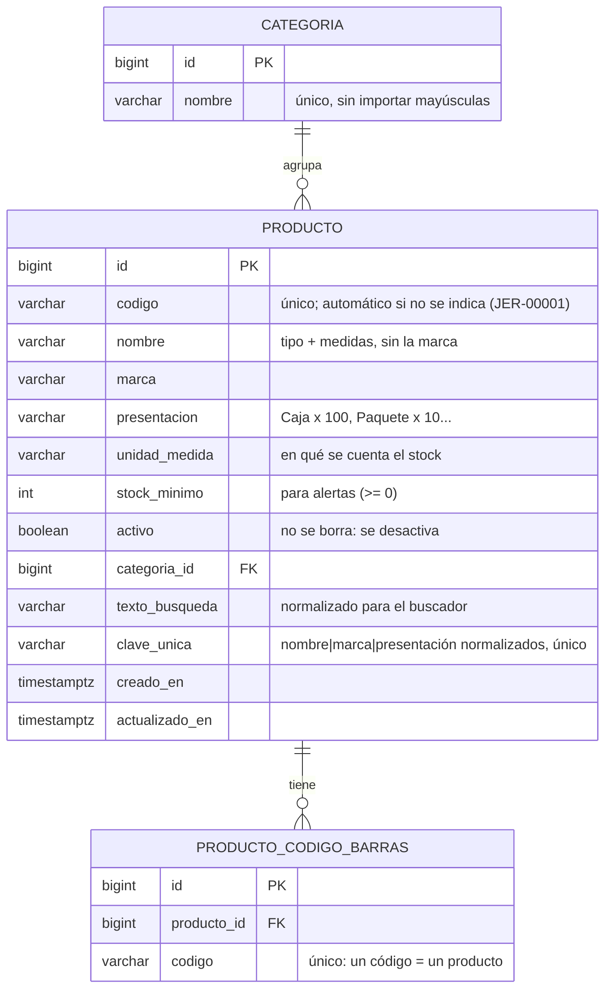

# Modelo de datos

El esquema se crea con migraciones de Flyway en [`backend/src/main/resources/db/migration`](../backend/src/main/resources/db/migration).

## Fase 1: Catálogo

### Decisiones

- **Cada marca o presentación es un producto distinto.** "Jeringa 5 ml · Marca A · Caja x 100" y "Jeringa 5 ml · Marca B · Caja x 100" son dos productos, porque los clientes piden marcas y el precio cambia.
- **Sin duplicados escritos de otra forma.** La columna `clave_unica` guarda nombre, marca y presentación *normalizados*, así que "Gasa estéril 10x10 cm" y "GASA ESTERIL 10 x 10 CM" se detectan como el mismo producto.
- **Un producto puede tener varios códigos de barras.** Por ejemplo, si el proveedor cambia el empaque. El código de barras identifica el producto, **no el lote**.
- **Los productos no se eliminan, se desactivan.** Más adelante tendrán historial de movimientos y pedidos.

### Cómo funciona el buscador

Al guardar un producto se calcula `texto_busqueda`: el código, el nombre, la marca y la presentación en minúsculas y sin tildes, con los números separados de las letras ("5ml" → "5 ml"). La búsqueda aplica la misma normalización y exige que **todas** las palabras coincidan:

| Se busca | Regla | Ejemplo |
|---|---|---|
| Palabra normal | Coincide con el **inicio** de una palabra | `jer` → **jer**inga |
| Número o letra suelta | Debe ser la palabra **completa** | `5` → "5 ml", pero no "x 50"; `m` → "talla M", pero no "Marca" |

## Próximas fases

- **Fase 2:** `lote` (número de lote, fecha de vencimiento, cantidad) y `movimiento` (entradas, salidas y ajustes).
- **Fase 3:** `cliente`, `pedido` y `pedido_item`.
